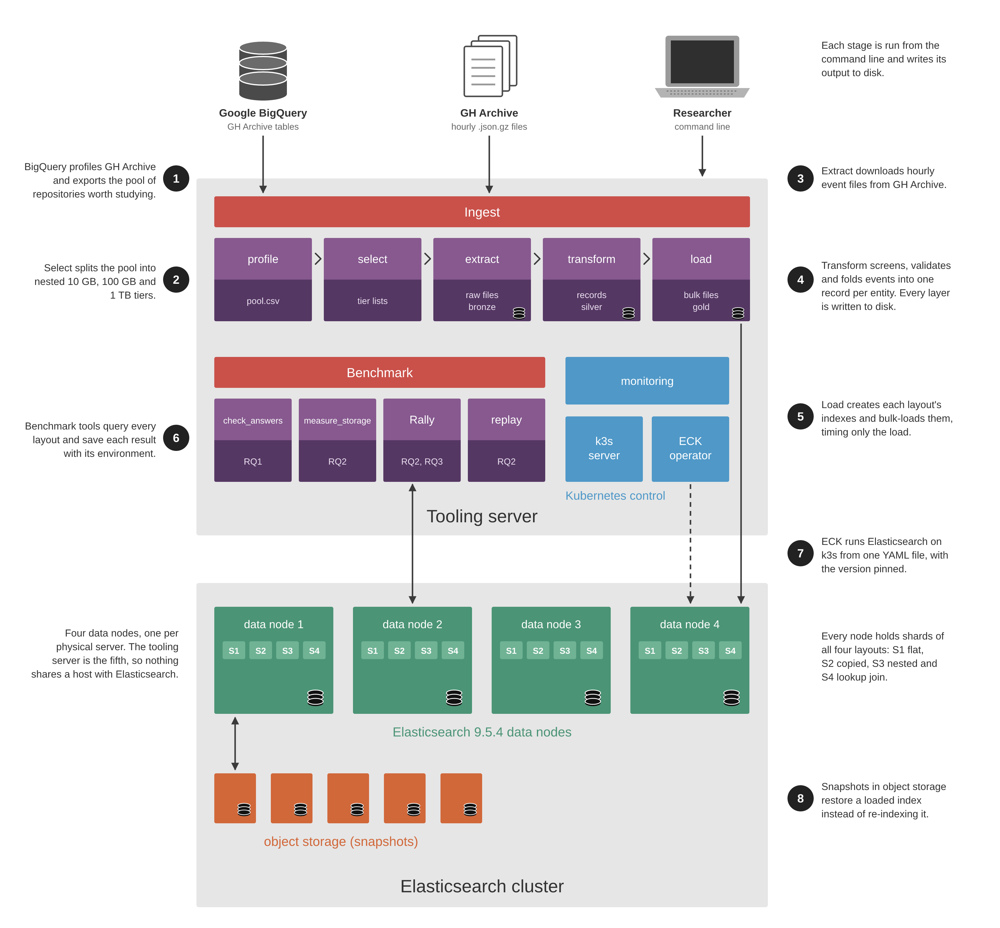

# Design

Few published examples show how to store large amounts of open source software (OSS) activity in distributed document layouts, and even fewer have actually been tested. One likely reason is that the topic sits at the intersection of NoSQL data modelling, distributed systems, Mining Software Repositories (MSR) and performance benchmarking. The constantly shifting distributed systems landscape, and limited access to high-performance compute, probably play a part too.

This thesis aims to address that gap. The findings are intended to inform a storage infrastructure that STASER-Lab can use for MSR research. Despite the shifting technology landscape, the experiments aim to produce results that hold beyond specific versions and dependencies. The research also has access to a high-performance compute cluster (Arbutus), which makes experiments at the terabyte scale possible.

The infrastructure has two parts. First, raw GitHub activity is ingested and converted into Elasticsearch indexes. Then a cluster stores and serves them during experiments, while separate tools benchmark each layout.

## Architecture

The diagram shows how the components fit together. Its numbered steps follow the data from GH Archive to the benchmark results, and the sections below follow the same order.

## Profile

Before any components were written, preliminary experiments were run on the GH Archive dataset using Google BigQuery. Targeted SQL queries profiled the shape of the 2024 data: how many events there are and how large they are, how unevenly activity is spread across repositories, and how much of it comes from bots or throwaway repositories. This profiling is the foundation for several design decisions, from the size of each data tier to the rules that filter repositories. The full analysis is on the [Profile](profile.md) page, and the SQL queries are in `ingest/profile/`. BigQuery's sandbox includes 1 TB of free queries per month, which was enough for this work.

The profiling also determined which repositories to study. A repository is kept only if it has at least 3 distinct accounts, no single account makes more than 80% of its events, and it averages at most 1,000 events per account. This removes near-empty, single-person and bot-driven repositories: 1,078,278 of 7,724,086 repositories remain, holding 64% of 2024's events. Forks can't be identified cheaply in BigQuery, so they are dropped later, during Transform.

{: .note }
This research uses GH Archive data from 2024 and the start of 2025 because on October 7, 2025, GitHub trimmed several fields from event payloads, including some pull request fields ([GitHub changelog](https://github.blog/changelog/2025-08-08-upcoming-changes-to-github-events-api-payloads/)). Data from before the change keeps every event in the same shape. Around one year of event data is more than enough for experiments of up to 1 TB of raw JSON.

## Ingest

With the dataset profiled, the ingest component was built as an ETL (extract, transform and load) process. It follows a [medallion architecture](https://www.databricks.com/glossary/medallion-architecture), where data moves through three layers of increasing quality, as labelled on the ingest stages in the architecture diagram: bronze (the raw hourly files in `data/raw/`), silver (the cleaned records in `data/records/`) and gold (the per-layout bulk files in `data/bulk/`). Every layer is written to disk, so each stage can be re-run or inspected on its own.

### Select

Experiments run at three data tiers: 10 GB, 100 GB and 1 TB. `ingest/select/build_tiers.py` builds each tier as a list of repositories, drawn from the filtered pool exported from BigQuery (`pool.csv`). A handful of repositories hold most of the activity, so a plain random sample would be dominated by a few giants. Instead, repositories are grouped into size bands by event count (3–9, 10–99, 100–999 and so on), and each tier fills every band with the same share of its events that the band has in the pool. Each tier contains the smaller one, a fixed random seed makes the lists repeatable, and no repository may make up more than 10% of a tier.

`select/` is its own stage because it does not touch any event data. It only decides which repositories the rest of the pipeline keeps. The tier lists are committed, so the tiers can be reproduced without BigQuery.

### Extract

`download_hours.py` downloads GH Archive's hourly files (compressed JSON event logs) from data.gharchive.org for a chosen date range. Each file goes to a temporary `.part` file and is only renamed once it decompresses completely, so a file under its final name is always whole. Re-running the command skips files that are already there, so a second run only retries the hours that failed. Every attempt is logged in a `manifest.csv` in the output folder, including hours that are missing from GH Archive. The files are saved to `data/raw/` as `YYYY-MM-DD-H.json.gz` (GH Archive does not zero-pad the hour).

### Transform

This is arguably the most important component in the infrastructure, because it is where the data is shaped for the experiments.

`build_records.py` runs each step of the transformation in order, turning raw event logs into one record per entity (repository, person, issue, pull request, comment, review and link):

1. **Screen.** `screen.py` keeps only the five event types used in the experiments: IssuesEvent, PullRequestEvent, IssueCommentEvent, PullRequestReviewEvent and PullRequestReviewCommentEvent.

2. **Filter repositories.** When a tier list is given (`--repos`), events from repositories not on the list are dropped here, before any further work.

3. **Validate.** `validate.py` rejects malformed events (missing fields or badly formatted timestamps) and duplicates.

4. **Fold.** `fold.py` combines events into records. Every event that touches an issue or pull request carries a full snapshot of it, so each record takes its fields from the latest event. For example, a pull request may be opened, commented on several times and then merged. It becomes one pull request record in its merged state, with each comment as its own record. A comment can even create its parent: a pull request opened before 2024 but discussed in 2024 is still recorded, with its real creation date. Folding also flags bot authors using `bots.py` (a curated list of known bots plus a rule for logins ending in "bot"), and drops forks, which can only be identified from pull request events.

5. **Link.** `links.py` reads pull request descriptions for GitHub's closing keywords, such as "Fixes #42", and records a link from the pull request to the issue it closes. Links were added later in the design because they are the only many-to-many relationship in the data: a pull request can close several issues, and an issue can be closed by several pull requests. Only descriptions are parsed, so links made in other ways (for example, manually in GitHub's sidebar) are missed.

{: .note }
Because this research is focused on storage layouts, not every available field is extracted, only what the experiments need to be realistic.

Large tiers raise a memory problem, because folding needs all of a repository's events at once. To bound peak memory, accepted events are first written to disk in buckets by repository (`--buckets`), and each bucket is folded on its own. Only people span repositories, so the result is identical to folding everything at once.

The output is one NDJSON (newline-delimited JSON) file per entity in `data/records/`, such as `pull_request.ndjson`, plus a `summary.json` that reports what was kept, what was rejected and why.

### Load

Load is the last step of the ingest process. It is responsible for indexing the newly built records into Elasticsearch.

Before indexing can happen, the records are turned into bulk files: the format Elasticsearch's Bulk API expects, with one set per layout. `build_bulk.py` handles this, and it is where the four layouts take shape:

- **S1 (flat):** one index per entity. Queries join related records in the client.
- **S2 (copied):** like S1, but each child carries copies of its parent's fields (`parent_*`. Links carry `pr_*` and `issue_*`), so a filter on the parent needs no join.
- **S3 (nested):** comments, reviews and links are nested inside their issue or pull request, so there are no child indexes.
- **S4 (lookup join):** the same documents as S1, but parents are lookup indexes, joined at query time with ES\|QL's `LOOKUP JOIN`.

The bulk files and a `summary.json` are saved in `data/bulk/<layout>/`. For S3, the summary also counts documents with more nested objects than Elasticsearch's default limit (10,000). Elasticsearch rejects those documents at load, so the count shows where nesting stops scaling.

`mappings.py` completes the picture of how the four layouts are indexed. It is critical to the research project, as it defines the schema (mapping) of every index in every layout, down to each field's type. A field has the same type in every layout, so layouts are compared like for like. The mappings are also strict: a field without a mapping fails the load instead of being added silently.

With the bulk files built, `index_bulk.py` creates one layout's indexes from `mappings.py`, then sends its bulk files in fixed-size batches and times only the bulk requests. It refuses to load into indexes that already hold documents, because that would time updates rather than inserts. `--recreate` replaces them. Once indexing is complete, it confirms every document arrived and saves detailed results to `data/results/`.

`connect.py` supports every tool that talks to Elasticsearch. It connects through the Python client using environment variables or an elastic-start-local `.env` file, and it saves each result file together with the environment it ran in (Elasticsearch and Python versions, host and time), so results from different machines can be compared.

## Benchmark

Once the layouts are loaded into Elasticsearch, the benchmark component evaluates them.

### Queries

The benchmark revolves around seven queries based on CHAOSS metrics, defined in `benchmark/queries/`. Each one asks about a single repository, and PR stands for pull request:

1. **Q1:** issues and PRs opened per month in a repository (single-entity baseline)

2. **Q2:** time from PR opened to first response, per PR
    - A response is the earliest comment or review by a human other than the PR author.
    - Covers human PRs opened in the window. An unanswered PR maps to None.

3. **Q3:** share of human PRs merged in the window that were reviewed
    - A review counts only if a human other than the PR author wrote it.

4. **Q4:** median time to first response (Q2) for first-time vs regular PR authors
    - An author is first-time if they had no activity in the repository before opening the PR. Activity before the window is not seen.

5. **Q5:** per monthly cohort of first-time contributors, the share active again within 90 days

6. **Q6:** share of issues closed in the window that a merged PR's closing keyword targets, and the median time from the issue opening to that PR's merge
    - The merge itself may fall outside the window.

7. **Q7:** share of human PRs merged in the window whose body closes at least one issue

Together they cover four kinds of access: a single entity (Q1), one hop from a parent to its children (Q2, Q3), a person's history (Q4, Q5), and links between entities (Q6, Q7).

Each query has a Python reference that computes the answer straight from the records, plus one implementation per layout using the Elasticsearch Query DSL or ES\|QL. Every layout must return exactly the reference answer. `common.py` holds helpers shared by several queries, such as the query window (2024 plus January to April 2025) and pagination. `contributors.py` collects each person's activity times in a repository, which the first-time contributor queries build on.

### Tools

`check_answers.py` runs every query on every layout and checks each answer against its Python reference. Each result is a pass, a fail, or a limit: by default, ES\|QL returns at most 10,000 rows, so on large repositories S4 cannot answer some queries exactly. That is recorded as a limit of the layout rather than an error. Results are saved so checks can be inspected in more detail.

`repositories.py` chooses the repositories the queries ask about: for each tier, the small, median and largest repository (by events) for which every query has a non-trivial answer. The choice is saved in `repositories.json`, which sits beside it, so every run, and anyone reproducing this work, asks about the same repositories.

`measure_storage.py` measures each layout's storage footprint. Interestingly, even once indexing is complete, Elasticsearch keeps merging index segments in the background, so the size right after loading depends on timing. The tool records that size, then force-merges each index to a single segment and measures again. Only the merged size is comparable between layouts and runs. Merging rewrites the indexes, so this runs last.

### Rally (Under construction)

Rally is Elasticsearch's benchmarking framework. The Rally tracks that measure query speed under load are in development. Rally will run on the cluster's tooling server, away from the Elasticsearch nodes, so it does not compete with them for resources.

## Cluster (Under construction)

Like Rally, the cluster's supporting services live apart from the Elasticsearch nodes. The cluster runs on five physical Arbutus servers: four each host one Elasticsearch data node (three are master-eligible), and the fifth hosts the tooling (Kubernetes control, ingest, Rally and monitoring), so nothing shares a host with a data node and skews the measurements. This section will be expanded as the cluster is built.

### OpenTofu

OpenTofu creates the virtual machines, private network and firewall on Arbutus from files in this repository, and places each data node on a different physical server. On first boot, cloud-init prepares each machine: updates, the kernel setting Elasticsearch needs, and the data disks.

### Kubernetes

k3s joins the machines into one Kubernetes cluster, and Elastic Cloud on Kubernetes (ECK) runs Elasticsearch from a single YAML file with the version pinned (9.5.4, the same version used in local development). Kubernetes was chosen over Docker Compose because one control machine can then manage every node, and resizing the cluster for experiments becomes a configuration change. Snapshots stored in Arbutus' object storage let a loaded index be restored instead of re-indexed.

## Tests

Tests live in `tests/`, with one file per component (select, extract, transform, load and benchmark), so each test is easy to find. They focus on correctness: anything that could silently change results is tested, while failures that would be loud anyway are not. GitHub Actions runs Ruff and the tests on every push and pull request.

## Documentation

This site is built from `documentation/` with Jekyll and Just the Docs, and the `pages.yml` workflow publishes it to GitHub Pages whenever `documentation/` changes on `main`. To preview it locally, run `bundle exec jekyll serve` inside `documentation/`.

- **Overview:** the motivation and goals of the research
- **Design:** how each component works and why
- **Profile:** the 2024 figures behind the tiers and the repository filter
- **Tutorial:** setup, running each stage, and the experiment plan
- **References:** data and tools, conventions, AI use and key decisions

The code is documented in its docstrings.
